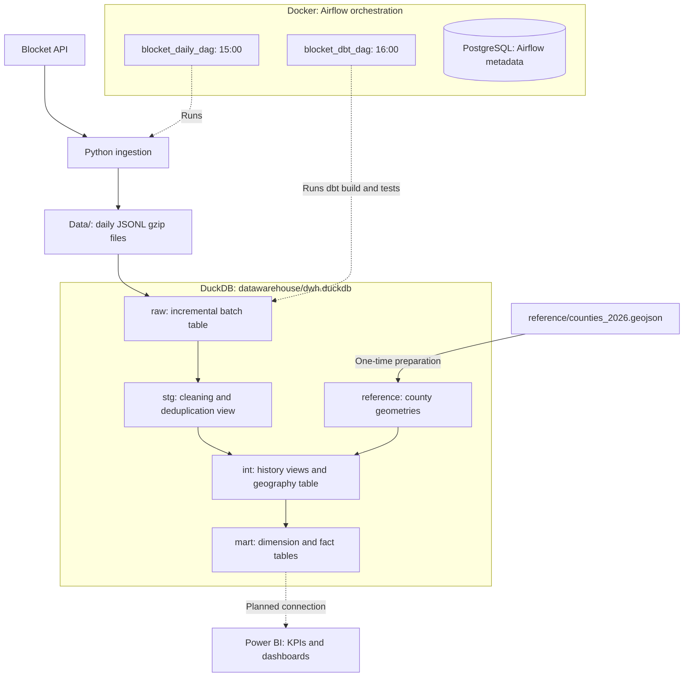
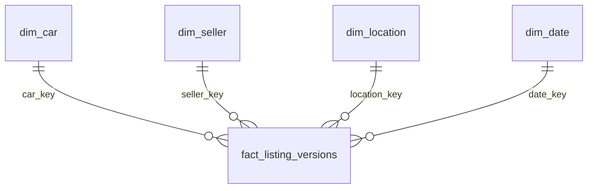

# Blocket Cars – End-to-End Data Engineering Pipeline

An end-to-end data engineering project that collects Swedish car listings from the Blocket API and automatically processes daily batches through each layer of a DuckDB data warehouse for analysis and BI.

The project demonstrates data ingestion, workflow orchestration, SQL transformations, dimensional modeling, data quality testing, and pseudonymization using best practices.

## 1. Tech Stack

| Technology | Purpose |
|---|---|
| Python | API integration and ETL |
| SQL | Data transformations (ELT) and analytics |
| Apache Airflow | Workflow orchestration and scheduling |
| Docker | Containerized development environment |
| DuckDB | Analytical data warehouse |
| dbt | SQL model maintenance, testing, and automated batch processing |


## 2. Architecture

The project separates API collection, file storage, warehouse transformations,
and analytical consumption. Python collects listing batches; dbt loads and
transforms them inside DuckDB. Airflow schedules both activities in Docker.
Power BI is the planned reporting layer and is not connected yet.




## 3. Data Pipeline

### Data Ingestion

- Fetches Swedish used-car listings using the Blocket API.
- Collects listing information across Swedish regions.
- Preserves raw API responses as JSONL files.
- Scheduled through Apache Airflow for daily execution.

### Data Transformation

Transformations are implemented with SQL and dbt.

| Layer | Responsibility |
|---|---|
| Raw | Preserve ingested data |
| Staging | Flatten, standardize, deduplicate, clean, and validate |
| Intermediate | Apply business rules and calculate new columns |
| Mart | Build a star schema for KPI analysis |
| Power BI | Not yet implemented! |

### Data Quality

| Layer | Main checks |
|---|---|
| Raw | Non-empty file · ≥2,000 rows · Time window · Volume drop |
| Staging | Unique observations · Required fields · Allowed values · Row loss |
| Intermediate | Same row count as staging · Sale type · Price flag · Region |
| Mart | Unique keys · Required keys · Dimension relationships |

| Result | Behavior |
|---|---|
| ✅ PASS | Continue |
| ⚠️ WARN | Continue and investigate |
| ❌ ERROR | Fail the command; dependent models may be skipped |

**Saved results:** `dwh.dbt_test__audit` — latest results per enabled test.


## 4. Data Warehouse Design

The analytical warehouse is stored in `datawarehouse/dwh.duckdb`. PostgreSQL is
used separately for Airflow metadata, not for the analytical models.

### Layers and Materialization

| Schema | Object | Materialization and responsibility |
|---|---|---|
| `raw` | `blocket_car_listings` | Incremental table retaining loaded batches; rerunning a non-empty file replaces rows with the same `source_file`. |
| `stg` | `stg_blocket_car_listings` | View that flattens nested fields, normalizes text, assigns types, and deduplicates observations. |
| `int` | `int_blocket_car_listing_versions` | View adding sale type, previous price, price changes, price validity, and car age. |
| `int` | `int_blocket_car_listing_geography` | Table adding county/region from coordinates; fully rebuilt when the model runs. |
| `mart` | Four dimensions and two facts | Tables fully rebuilt whenever their models run. |
| `reference` | `region_geo_boundaries` | Prepared county geometry table used by the geography model. |
| `dbt_test__audit` | Saved test results | Latest result tables for tests configured with `store_failures=true`. |

Raw duplicates are preserved. Staging keeps one observation per
`(listing_id, uploaded_at, source_file)`. The same listing and publication
timestamp in different source files remain separate observations. If records
with the same three-field key have different values, the current deduplication
has no defined winner between them.

### Mart Star Schema

All dimensions and facts are tables rebuilt from the intermediate layer.
Car, seller, location, and listing-version keys are numeric surrogate keys
generated with ROW_NUMBER inside their respective models. The date key is YYYYMMDD.
Keys can change when the source data changes. Facts look up dimension IDs using
NULL-safe attribute comparisons, so rebuild the entire mart together (from the
dbt project directory):

```powershell
dbt build --profiles-dir . --select mart
```

Refresh downstream exports together because surrogate keys are not stable across rebuilds.

| Model | Grain: what one row represents | Key |
|---|---|---|
| `dim_car` | One distinct combination of make, series, model, specification, model year, transmission, fuel, and registration class. | `car_key` |
| `dim_seller` | One distinct combination of seller identity and descriptive attributes. | `seller_key` |
| `dim_location` | One distinct `(region, location)` combination. | `location_key` |
| `dim_date` | One calendar day between the earliest and latest publication dates, including days without observations. | `date_key` |
| `fact_listing_versions` | One listing observation per `(listing_id, uploaded_at, source_file)`. | `listing_version_key` |
| `fact_listing_latest` | One selected latest observation per `listing_id`. | `listing_id` is unique; the selected row retains its `listing_version_key`. |




## 5. Analytics & KPIs

In progress.

## 6. Project Structure

```text
Datapipe/
├── airflow/
│   ├── .env                       # Local settings and persistent keys
│   ├── config/                    # Airflow configuration
│   ├── dags/
│   │   ├── blocket_daily.py        # Daily ingestion DAG
│   │   └── blocket_dbt.py          # Daily dbt build DAG
│   ├── docker-compose.yaml        # Airflow services and PostgreSQL metadata DB
│   ├── Dockerfile                 # Airflow image with project dependencies
│   ├── logs/                      # Generated task logs
│   └── plugins/                   # Plugin directory
├── Data/                          # Local batches: blocket_cars_YYYY_MM_DD.jsonl.gz
├── datawarehouse/dwh.duckdb        # Warehouse and saved test results
├── dbt/blocket_cars_pipeline/
│   ├── dbt_packages/               # Generated by dbt deps
│   ├── dbt_project.yml             # Project configuration
│   ├── logs/                       # dbt logs
│   ├── macros/                     # Reusable Jinja functions
│   ├── models/
│   │   ├── int/                    # Listing history, prices, and geography
│   │   ├── mart/                   # Dimensions and version/latest facts
│   │   ├── raw/                    # Incremental daily-file loading
│   │   └── stg/                    # Flattening, normalization, and deduplication
│   ├── package-lock.yml            # Resolved package versions
│   ├── packages.yml                # dbt dependencies
│   ├── profiles.yml                # DuckDB connection and lint target
│   ├── seeds/                      # Location reference CSV; not used by current models
│   ├── target/                     # Generated SQL and execution artifacts
│   ├── tests/raw/                  # File and batch quality checks
│   └── tests/stg/                  # Raw-to-staging row-loss check
├── pyproject.toml                  # Python dependencies, packaging and SQLFluff configuration
├── README.md
├── reference/counties_2026.geojson # County boundaries for reference data
├── reference/load_counties.sql     # One-time county import into DuckDB
└── src/                           # Python ingestion and file handling
    ├── encryption.py              # Deterministic AES-SIV encryption
    ├── ingestion.py               # API requests, pagination, and time filtering
    ├── run_ingestion.py           # Fetch, encrypt identifiers, and save a batch
    └── save_list_to_jsongz.py      # Atomic gzip-compressed JSONL writes
```

Data files, database files, secrets, and generated dbt/Airflow outputs are local
artifacts excluded by `.gitignore`. The optional local historical reload script
`load_all_local_to_raw.sql` is also ignored and is not included in the repository.

## 7. Getting Started

Requires Python 3.11+ and Docker Desktop with Linux containers. Run these PowerShell commands from the project root.

### Configure and Start Airflow

Create `airflow/.env` with the following values (reuse existing keys if already configured):

```dotenv
ENCRYPTION_KEY=<Base64-encoded 64-byte key>
FERNET_KEY=<Fernet key>
AIRFLOW__API_AUTH__JWT_SECRET=<random secret>
_AIRFLOW_WWW_USER_PASSWORD=<your admin password>
```

```powershell
python -m pip install -e .
cd airflow
docker compose up -d --build
```

### One-time Preparation

Once Airflow is running, install the dbt packages and run
[`reference/load_counties.sql`](reference/load_counties.sql) to import the bundled county boundaries into `datawarehouse/dwh.duckdb`:

```powershell
docker compose exec -w /opt/airflow/project/dbt/blocket_cars_pipeline airflow-scheduler dbt deps --profiles-dir .
docker compose exec -w /opt/airflow/project airflow-scheduler python -c "from pathlib import Path; import duckdb; db = duckdb.connect('datawarehouse/dwh.duckdb'); db.execute(Path('reference/load_counties.sql').read_text()); db.close()"
```

Open [Airflow](http://localhost:8080), log in as `airflow` with your configured password,
and enable `blocket_daily_dag` and `blocket_dbt_dag`. They run at 15:00 and 16:00
(Stockholm time), with catchup enabled. Results are stored in `datawarehouse/dwh.duckdb` under `mart`.

### Trigger a batch manually

To test immediately, use **Trigger DAG** in Airflow: run `blocket_daily_dag` first,
wait for it to succeed, then trigger `blocket_dbt_dag`. Set `batch_date` to the batch's
Stockholm date (`YYYY-MM-DD`) and `batch_window_end` to the ingestion window's end
(ISO timestamp with timezone offset) so the time-window test matches the manual batch.
Manual ingestion fetches listings from the preceding 24 hours using the current time.
`batch_window_end` only controls dbt's validation window; if omitted, it defaults to 15:00 Stockholm time on `batch_date`.

## 8. Technical Design Decisions

### Why DuckDB?

DuckDB provides a free, local alternative to cloud-based OLAP databases.

### Why dbt?

dbt organizes SQL transformation logic, automates testing, and encourages a standardized pipeline structure.

### Why Apache Airflow?

Airflow provides workflow orchestration, scheduling, task dependencies, monitoring, and catchup runs after downtime.

### Why Dimensional Modeling?

A star schema simplifies analytical queries, supports BI tools, and separates measurable business events from descriptive attributes.

### Why Pseudonymize VINs and Registration Numbers?

VINs (chassis numbers) and registration numbers can be linked to individual vehicle owners. Pseudonymization reduces direct exposure of these identifiers while preserving the ability to match records for the same vehicle across batches.

## 9. Limitations

- Listing locations are entered by users and may be inaccurate. The region is derived from GPS coordinates and used as the authoritative region for each row.
- Data collection depends on the availability and structure of the external API.
- Price changes made more than 24 hours after publication are not monitored. Tracking them would require fetching all listings daily.

## 10. Next Steps / Future Improvements

- Expand data quality checks.
- Add KPIs.
- Connect to Power BI and implement dashboards.
- Add checks that listing locations fall within their assigned regions.
